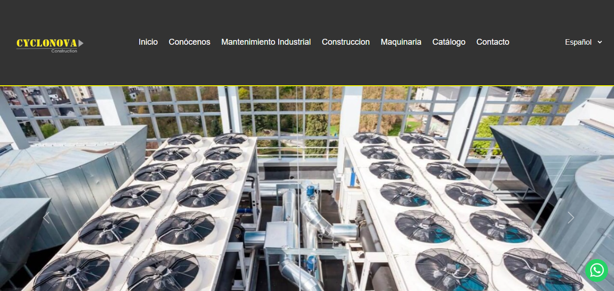
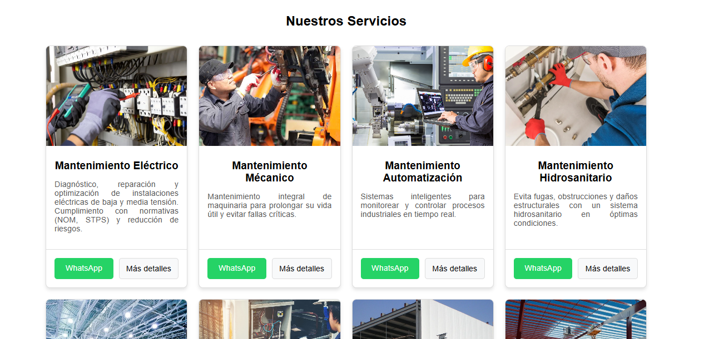
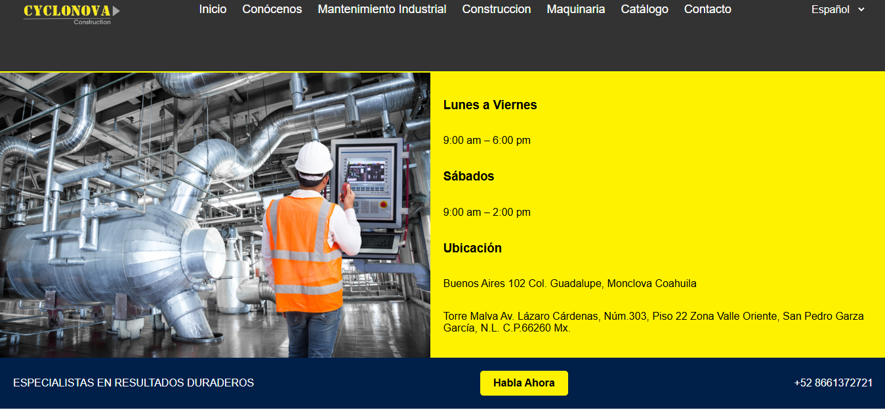

# 🌐 Cyclonova | Corporate Website

**Desarrollo de plataforma web corporativa para Cyclonova**, empresa enfocada en servicios de construcción, mantenimiento industrial, automatización e infraestructura.

Proyecto desarrollado para fortalecer la presencia digital de la empresa mediante un sitio web responsivo, orientado a la presentación de servicios, captación de clientes potenciales y comunicación directa.

---

## 📌 Descripción del proyecto

Cyclonova es un sitio web corporativo diseñado para centralizar y presentar la información de la empresa, sus áreas de especialización y su catálogo de servicios.

La plataforma ofrece una experiencia de navegación intuitiva, adaptable a distintos dispositivos y enfocada en facilitar el acceso a la información y los medios de contacto.

El desarrollo contempla tanto la interfaz visual como funcionalidades del lado del servidor para gestionar determinados elementos del sitio.

## ✨ Funcionalidades principales

- **Diseño responsivo:** adaptación de la interfaz a computadoras, tablets y dispositivos móviles.
- **Presentación corporativa:** secciones informativas sobre la empresa, experiencia y capacidades.
- **Catálogo de servicios:** organización y presentación de las diferentes soluciones ofrecidas.
- **Formulario de contacto:** mecanismo para facilitar la comunicación con clientes potenciales.
- **Integración con WhatsApp:** acceso directo a canales de atención y contacto comercial.
- **Contenido visual:** presentación de maquinaria, equipo especializado y proyectos relacionados con los servicios.
- **Navegación intuitiva:** estructura organizada para mejorar la experiencia del usuario.
- **Soporte multilingüe:** presentación de contenido en español e inglés.

## 🏗️ Áreas de servicio presentadas

| Categoría | Servicios |
|---|---|
| Construcción | Construcción e infraestructura |
| Mantenimiento | Eléctrico, mecánico e hidrosanitario |
| Automatización | Automatización industrial |
| Instalaciones | Iluminación industrial, aire acondicionado y refrigeración |
| Servicios especializados | Trabajos en alturas, impermeabilización y limpieza industrial |
| Servicios generales | Jardinería y paisajismo |
| Maquinaria | Renta y operación de maquinaria especializada |

## 🛠️ Tecnologías utilizadas

**Frontend**
- HTML5
- CSS3
- JavaScript
- Bootstrap

**Backend**
- PHP
- MySQL

## 📸 Capturas de pantalla

### Página de inicio


### Catálogo de servicios


### Sección de contacto


## 📂 Estructura del proyecto

```text
Cyclonova/
│
├── assets/
│   ├── css/
│   ├── js/
│   └── img/
│
├── includes/
├── servicios/
├── index.php
└── README.md
```

*La estructura mostrada es representativa y puede variar según la versión del proyecto.*

## ⚙️ Instalación y configuración

### Requisitos previos

- Servidor local compatible con PHP (XAMPP, WAMP o similar).
- PHP.
- MySQL.
- Navegador web moderno.

### Pasos de instalación

1. Clonar el repositorio:

```bash
git clone https://github.com/eherca0502/paginawebcyclo.git
```

2. Colocar el proyecto dentro del directorio público del servidor local.

3. Iniciar Apache y MySQL.

4. Configurar los parámetros de conexión a la base de datos según la configuración del proyecto.

5. Abrir el sitio desde el navegador:

```text
http://localhost/paginawebcyclo/
```

## 🎯 Objetivos del desarrollo

- Fortalecer la presencia digital de la empresa.
- Presentar de manera estructurada sus servicios y capacidades.
- Facilitar el contacto con clientes potenciales.
- Ofrecer una experiencia de navegación accesible y adaptable.
- Implementar una solución web utilizando tecnologías de desarrollo frontend y backend.

## 👨‍💻 Autor

**Eduardo Hernández**

Software Developer |

- GitHub: [@eherca0502](https://github.com/eherca0502)
- Portafolio: [eherca-portafolio.netlify.app](https://eherca-portafolio.netlify.app)

---

<sub>Proyecto de desarrollo web corporativo realizado para Cyclonova.</sub>

